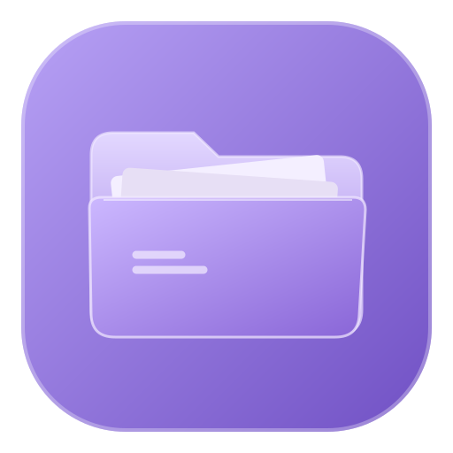
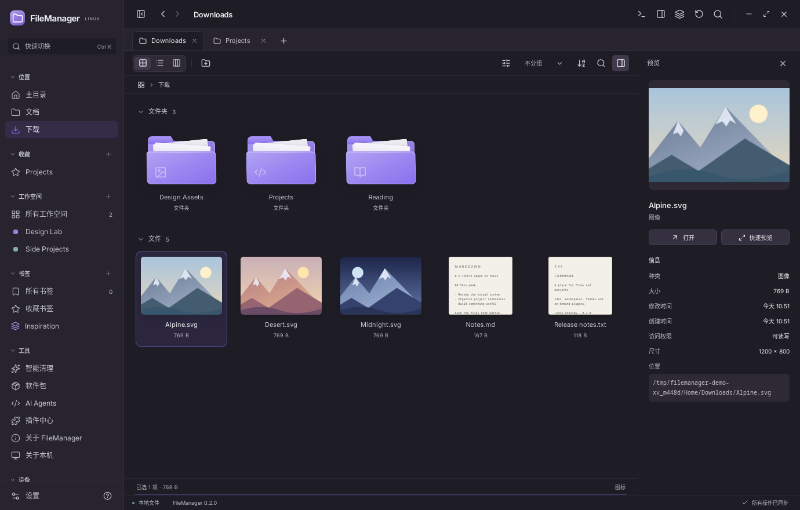
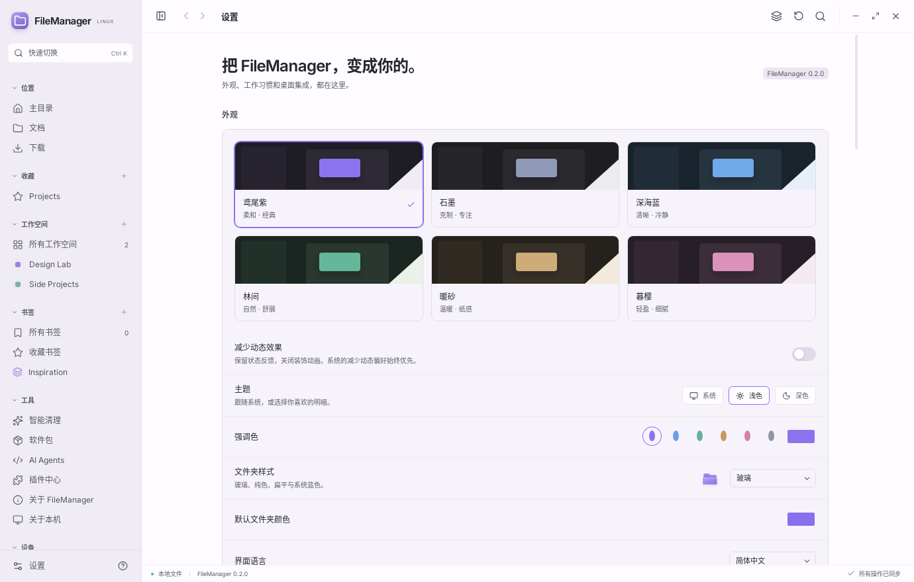
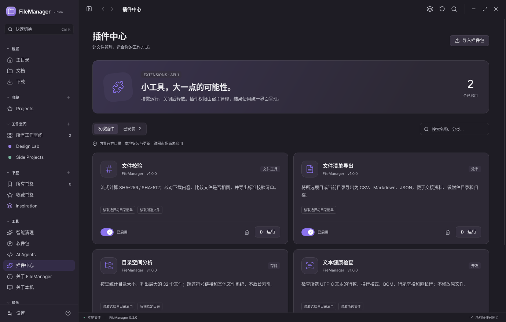

<p align="center">
  
</p>
<h1 align="center">FileManager</h1>
<p align="center">A desktop file manager for Linux, built with Tauri and Rust.</p>
<p align="center">
  <a href="README.md"><strong>English</strong></a> · <a href="README.zh-CN.md">简体中文</a>
</p>
<p align="center">
  <a href="https://github.com/dBevil-z/FileManager/actions/workflows/linux.yml"></a>
  
  <a href="https://github.com/dBevil-z/FileManager/releases/latest"></a>
</p>

Browse files, collect project references, preview documents, and add focused tools through plugins. FileManager brings tabs, dual panes, workspaces, bookmarks, and a personal visual style into one Linux application.



<p align="center"><em>Real application captures with demonstration files. No personal documents are shown.</em></p>

[Features](#features) · [Get started](#get-started) · [Plugins](#plugins) · [Technology](#technology) · [Roadmap](ROADMAP.md) · [Contribute](CONTRIBUTING.md)

## Features

| Area                 | What you can do                                                                                                                                                                     |
| -------------------- | ----------------------------------------------------------------------------------------------------------------------------------------------------------------------------------- |
| File browsing        | Switch between icons, list, and columns; restore folder tabs; use dual panes, breadcrumbs, path completion, filtering, and virtualized rows.                                        |
| File operations      | Copy, move, duplicate, rename in batches, create links, review name conflicts, cancel queued work, and recover through persistent undo and Trash.                                   |
| Preview and writing  | Inspect images, PDF pages, media, text, and supported office documents. Edit Markdown with split preview, local images, and unsaved-change protection.                              |
| Project organization | Group files, folders, and links into reference-based workspaces. Manage bookmarks, collections, tags, and favourites.                                                               |
| Storage tools        | Review downloads, organize by category, inspect duplicates and large files, and browse installed packages. Cleanup remains a reviewed action.                                       |
| Remote storage       | Browse and transfer files in the background over MinIO, S3-compatible storage, Alibaba Cloud OSS, SFTP, FTP, and explicit FTPS. See the [connection guide](docs/remote-storage.md). |
| Developer tools      | Inspect Git status, open terminals and editors, manage local AI project/MCP configuration, review supported usage logs, and inspect local services.                                 |
| Personalization      | Choose six light/dark skins, folder colours and symbols, a system theme, shortcuts, and reduced motion.                                                                             |
| Desktop integration  | Use Drop Shelf, the system tray, optional login startup, CLI/deep links, and KDE KRunner/D-Bus integration.                                                                         |
| Extensions           | Install, review, enable, update, or remove local plugins. Launch tools from the plugin center or a file's context menu.                                                             |

See the [feature matrix](docs/features.md) for implementation evidence and platform limits.

### Continue where you left off

Switching menus restores the last directory or detail page, along with filters, view controls, selection, and scroll position. Remote storage remembers the connection, Bucket, directory, and page. These positions also survive a restart; completed scan results remain available only while the backend retains them during the current run.

Use **Settings → Browsing and restore** to disable this behavior or reset menu positions. Inactive pages release their previews. Durable UI snapshots are limited to 256 KiB / 256 entries; remote list metadata is cached for at most four minutes, four locations, and 2 MiB. Credentials and server cursors are never written into UI snapshots.

### Make it yours

Six coordinated skins: **Iris, Graphite, Ocean, Forest, Sand, and Rose**. Each supports light and dark mode, with custom accents and folder styles.



### Plugins that run when you need them

The plugin center ships a local catalog. Plugins run in a fresh QuickJS runtime and return results through a consistent application UI; installed plugins do not create resident browser windows.



| Included plugin | Purpose                                                                                              |
| --------------- | ---------------------------------------------------------------------------------------------------- |
| File checksums  | Stream SHA-256/SHA-512 hashes, compare an expected digest, and export checksum lists.                |
| File inventory  | Export selected entries or a directory listing as CSV, Markdown, or JSON.                            |
| Text inspection | Inspect UTF-8 text, line endings, BOMs, trailing spaces, and long lines.                             |
| Directory space | Count logical file sizes and list the largest files without following links or crossing filesystems. |

A signed online marketplace and downloadable theme packs are [planned](ROADMAP.md). The current catalog and local `.fmp` installation work without an online marketplace.

## Get started

**Current validation:** Linux x86_64 on Ubuntu 24.04 with KDE/X11. Other distributions, Wayland, ARM64, and older system-library baselines are being evaluated. Windows and macOS are outside the current implementation scope.

### Download a release

[**Download FileManager for Linux**](https://github.com/dBevil-z/FileManager/releases/latest) · [Release notes](https://github.com/dBevil-z/FileManager/releases) · [Update guide](docs/releases.md)

- **Ubuntu/Debian:** download the `.deb` and install it with `sudo apt install ./FileManager_0.2.4_amd64.deb`.
- **AppImage:** download, mark executable and run. FUSE-free launch: `./FileManager_0.2.4_amd64.AppImage --appimage-extract-and-run`.
- Check **Settings / About → Software updates** for newer stable releases. Downloads are signed; installation and restart remain explicit. Versions before 0.2.4 need a one-time manual upgrade.

Packages are built on Ubuntu 24.04. AppImage does not remove the host glibc baseline or guarantee every Linux distribution. `SHA256SUMS` and version-bound updater signatures accompany each release.

### Build from source

Install Rust 1.91 or newer, Node.js 24, and pnpm 10. On Ubuntu/Debian, install the development libraries:

```bash
sudo apt update
sudo apt install -y libwebkit2gtk-4.1-dev build-essential curl wget file \
  libxdo-dev libssl-dev libayatana-appindicator3-dev librsvg2-dev patchelf

git clone https://github.com/dBevil-z/FileManager.git
cd FileManager
pnpm install --frozen-lockfile
pnpm desktop
```

Optional integrations use **Poppler** for PDF previews, **FFmpeg** for media information/thumbnails, **LibreOffice** for office previews, and **KDE Connect** for sending files. Missing tools are reported in the relevant feature.

### Package and install

```bash
pnpm tauri build

# Install for the current user; leaves the system default file manager unchanged.
./scripts/install-user.sh

# Alternatively, install the Debian package:
sudo apt install ./target/release/bundle/deb/FileManager_0.2.4_amd64.deb

# Or run the generated AppImage:
chmod +x target/release/bundle/appimage/FileManager_0.2.4_amd64.AppImage
./target/release/bundle/appimage/FileManager_0.2.4_amd64.AppImage
```

Choose one installation method to avoid duplicate launchers. Search for **FileManager** in your application menu after installing. Stable version tags trigger the signed Release workflow after checks pass. Ordinary source pushes run checks without publishing. See the [maintainer guide](docs/releases.md).

### Everyday shortcuts

| Shortcut            | Action                    | Shortcut         | Action          |
| ------------------- | ------------------------- | ---------------- | --------------- |
| `Ctrl+T` / `Ctrl+W` | Open / close a folder tab | `Ctrl+Tab`       | Next folder tab |
| `Ctrl+K`            | Quick switcher            | `Ctrl+L`         | Enter a path    |
| `Space`             | Quick preview             | `F2`             | Rename          |
| `F5` / `F6`         | Copy / move between panes | `Ctrl+Alt+Space` | Drop Shelf      |

Shortcuts can be customized in Settings. Global shortcuts and drag-and-drop depend on the desktop session; Wayland behavior is still being verified.

## Plugins

A plugin is a ZIP-based `.fmp` containing `manifest.json` and `main.js`. Start from the template:

```bash
cp -r plugins/template /tmp/my-filemanager-plugin
# Edit the manifest and script.
python3 scripts/pack-plugin.py /tmp/my-filemanager-plugin /tmp/hello-1.0.0.fmp
```

Import it through **Plugin Center → Import package**, review its permissions, and run it without rebuilding the application.

```js
function main(context, api) {
  return {
    title: "Selected files",
    columns: ["Name", "Bytes"],
    rows: context.selection.map((file) => [file.name, file.size]),
  };
}
```

API v1 provides bounded metadata access, selected-file reads/hashing, directory statistics, and reports. The host handles rendering, export locations, conflict protection, and undo. Each invocation has a **32 MiB JavaScript heap** and a **30-second task deadline**. See the [SDK and capability model](docs/plugins.md) for exact limits.

## Technology

| Layer         | Stack                        | Responsibility                                                                    |
| ------------- | ---------------------------- | --------------------------------------------------------------------------------- |
| Desktop shell | Tauri 2, GTK, WebKitGTK 4.1  | Native windows, clipboard, tray, shortcuts, and desktop integration.              |
| Core          | Rust                         | File operations, metadata, previews, background work, cancellation, and recovery. |
| Interface     | React 19, TypeScript, Vite   | Browsers, tools, virtualized lists, theme tokens, and plugin result views.        |
| Persistence   | SQLite                       | Catalogs, settings, sessions, observed files, and undo journals.                  |
| Plugins       | QuickJS through `rquickjs`   | A fresh, capability-limited JavaScript runtime for each tool invocation.          |
| Presentation  | CSS variables, Lucide, Inter | Shared visual tokens, icons, typography, and six skins.                           |

```text
src/                       React interface, themes, and feature screens
src-tauri/                 Linux desktop integration and Tauri commands
crates/filemanager-core/    Filesystem, jobs, storage, previews, and plugin host
plugins/official/          Included plugin sources
plugins/template/          Minimal plugin example
scripts/                   User installation and plugin packaging
```

## Performance and local data

Version 0.2 separates thumbnails from detail previews, limits cache bytes and completed job results, serializes large image work, and releases idle Shelf/converter resources. One local post-install sample measured about **198 MiB PSS** for the complete application process tree. This is a measured example, not a fixed memory limit. The [validation record](docs/verification.md) describes the workload, RSS/PSS distinction, and remaining long-run checks.

New installations store data under `${XDG_DATA_HOME:-~/.local/share}/filemanager`. An existing `fileos/fileos.sqlite` is reused in place so catalogs and absolute undo backup paths remain valid. `FILEMANAGER_DATA_DIR` overrides storage; `FILEMANAGER_TEST_HOME` isolates test home/Trash paths.

FileManager has no account system or telemetry. Bookmark metadata, remote images, and explicitly opened external links can contact their respective websites. Cross-filesystem moves retain originals in the source filesystem's Trash for recovery; keep those backups until you no longer need undo.

## Project status and contributing

This is an **early preview**. Media codecs and desktop integrations depend on system tools; some new interface strings and plugin metadata are currently Chinese. Broad Linux compatibility, complete cross-application drag-and-drop testing, and a signed online marketplace remain on the [roadmap](ROADMAP.md). Signed application updates are available from 0.2.4.

Read [CONTRIBUTING](CONTRIBUTING.md), browse [Issues](https://github.com/dBevil-z/FileManager/issues), or propose a plugin. Visual inspiration comes from [FileOS for Mac](https://fileosmac.com/); Linux implementation and the extension architecture live in this repository.

A project license has not yet been selected. No MIT/Apache/GPL license is currently declared for this repository; dependencies retain their respective licenses.
