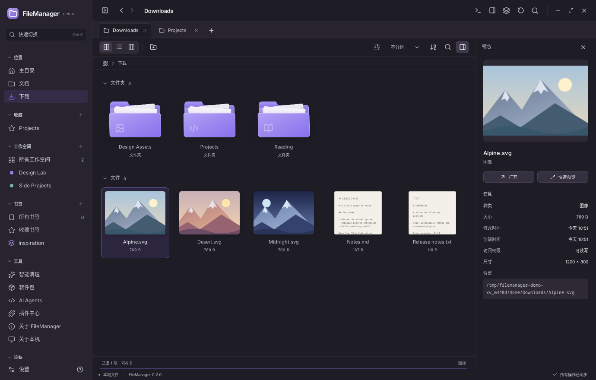
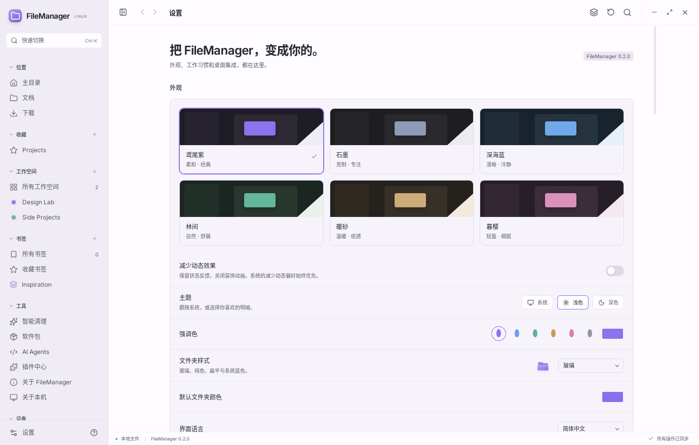

<p align="center">
  
</p>
<h1 align="center">FileManager</h1>
<p align="center">使用 Tauri 与 Rust 构建的 Linux 桌面文件管理器。</p>
<p align="center">
  <a href="README.md">English</a> · <a href="README.zh-CN.md"><strong>简体中文</strong></a>
</p>
<p align="center">
  <a href="https://github.com/dBevil-z/FileManager/actions/workflows/linux.yml"></a>
  
  <a href="https://github.com/dBevil-z/FileManager/releases/latest"></a>
</p>

浏览文件、收集项目资料、预览文档，再用插件处理日常小任务。FileManager 将多标签、双栏、工作空间、书签和可定制外观放进同一个 Linux 桌面应用。



<p align="center"><em>截图来自真实应用，使用演示文件，不包含私人文档。</em></p>

[功能](#功能) · [开始使用](#开始使用) · [插件](#插件) · [技术栈](#技术栈) · [路线图](ROADMAP.zh-CN.md) · [参与开发](CONTRIBUTING.zh-CN.md)

## 功能

| 分类       | 可以做什么                                                                                                                           |
| ---------- | ------------------------------------------------------------------------------------------------------------------------------------ |
| 文件浏览   | 图标、列表、分栏视图；多标签会话恢复、双栏、面包屑、路径补全、过滤和虚拟列表。                                                       |
| 文件操作   | 复制、移动、副本、批量重命名、链接、同名复核、任务取消，以及持久化撤销和回收站恢复。                                                 |
| 预览与写作 | 查看图像、PDF 页面、媒体、文本和受支持的 Office 文档；Markdown 支持分屏、本地图片和未保存保护。                                      |
| 项目组织   | 工作空间保存文件、文件夹与链接的引用；管理书签、集合、标签和收藏。                                                                   |
| 存储工具   | 查看下载概览、按类别整理、检查重复与大文件、浏览已安装软件包；清理经过复核后执行。                                                   |
| 远程存储   | 连接 MinIO、S3 兼容存储、阿里云 OSS、SFTP、FTP 和显式 FTPS；浏览目录并在后台上传、下载。见[接入指南](docs/remote-storage.zh-CN.md)。 |
| 开发工具   | 只读 Git 状态、终端和编辑器、本地 AI 项目/MCP 配置、受支持日志的用量统计与本机服务。                                                 |
| 外观定制   | 六套明暗皮肤、自定义强调色、文件夹颜色与符号、跟随系统、快捷键和减少动态效果。                                                       |
| 桌面集成   | Drop Shelf、托盘、可选登录启动、CLI/深层链接，以及 KDE KRunner/D-Bus。                                                               |
| 扩展能力   | 插件安装审核、启停、更新、卸载；从插件中心或文件右键菜单运行工具。                                                                   |

具体实现、验证证据与平台差异见[功能对照](docs/features.zh-CN.md)。

### 继续上次浏览

切换菜单后恢复上次的目录或详情页，以及筛选、视图、选择和滚动位置。远程存储还会记住连接、Bucket、目录和页码。位置可在重启后继续恢复；清理扫描结果只在本次运行内、后端仍保留结果时恢复。

在 **设置 → 浏览与恢复** 中可关闭记忆或重置各菜单位置。离开页面仍释放预览；持久化状态最多 256 KiB / 256 项，远程列表元数据最多缓存四分钟、四个位置和 2 MiB。凭据与服务端游标不会写入界面状态快照。

### 选择你的外观

六套协调的皮肤：**鸢尾紫、石墨、深海蓝、林间、暖砂、暮樱**。每套均支持明暗主题，并可调整强调色与文件夹样式。



### 需要时才运行的插件

插件中心自带本地目录。每次调用创建新的 QuickJS 运行时，结果使用应用统一界面呈现；已安装插件不会常驻额外网页窗口。


| 自带插件     | 用途                                                       |
| ------------ | ---------------------------------------------------------- |
| 文件校验     | 流式计算 SHA-256/SHA-512、比对期望校验值、导出校验清单。   |
| 文件清单导出 | 将所选项目或目录清单导出为 CSV、Markdown、JSON。           |
| 文本健康检查 | 检查 UTF-8 文本、换行、BOM、行尾空格和超长行。             |
| 目录空间分析 | 统计逻辑文件大小并列出最大文件，不跟随链接、不跨文件系统。 |

签名联网市场和可下载主题包在[后续计划](ROADMAP.zh-CN.md)中。当前本地目录与 `.fmp` 插件安装不依赖联网市场。

## 开始使用

**当前验证环境：** Linux x86_64、Ubuntu 24.04、KDE/X11。其他发行版、Wayland、ARM64 和较旧系统库基线正在规划验证。Windows、macOS 不属于当前实现范围。

### 下载发行版

[**下载 Linux 版 FileManager**](https://github.com/dBevil-z/FileManager/releases/latest) · [版本说明](https://github.com/dBevil-z/FileManager/releases) · [更新指南](docs/releases.zh-CN.md)

- **Ubuntu/Debian** 下载 `.deb` 后执行 `sudo apt install ./FileManager_0.2.5_amd64.deb`。
- **AppImage** 下载后赋予执行权限并运行。FUSE 不可用时，执行 `./FileManager_0.2.5_amd64.AppImage --appimage-extract-and-run`。
- 在 **设置 / 关于 → 软件更新** 中检查稳定版本，验证签名后由你选择安装、重启。0.2.4 以前的版本需要先手动升级一次。

安装包在 Ubuntu 24.04 构建；AppImage 仍依赖宿主 glibc 基线，不代表已兼容所有 Linux 发行版。每个 Release 包含 `SHA256SUMS` 和绑定版本号的更新签名。

### 从源码运行

准备 Rust 1.91 或更新的稳定工具链、Node.js 24 与 pnpm 10。Ubuntu/Debian 开发依赖：

```bash
sudo apt update
sudo apt install -y libwebkit2gtk-4.1-dev build-essential curl wget file \
  libxdo-dev libssl-dev libayatana-appindicator3-dev librsvg2-dev patchelf

git clone https://github.com/dBevil-z/FileManager.git
cd FileManager
pnpm install --frozen-lockfile
pnpm desktop
```

可选集成使用 **Poppler** 生成 PDF 预览、**FFmpeg** 读取媒体信息和缩略图、**LibreOffice** 转换 Office 预览、**KDE Connect** 发送文件。缺少工具时会在对应功能中提示。

### 打包与安装

```bash
pnpm tauri build --no-sign

# 当前用户安装，不改变系统默认文件管理器。
./scripts/install-user.sh

# 也可安装生成的 Debian 软件包：
sudo apt install ./target/release/bundle/deb/FileManager_0.2.5_amd64.deb

# 或运行生成的 AppImage：
chmod +x target/release/bundle/appimage/FileManager_0.2.5_amd64.AppImage
./target/release/bundle/appimage/FileManager_0.2.5_amd64.AppImage
```

本地源码构建使用 `--no-sign`，无需维护者私钥；正式发行版由发布工作流签名。

选择一种安装方式，避免重复菜单入口。安装后在应用菜单搜索 **FileManager**。稳定版本标签会在检查通过后触发签名 Release 发布，普通源码推送只运行检查。见[维护者指南](docs/releases.zh-CN.md)。

### 常用快捷键

| 快捷键              | 操作                | 快捷键           | 操作       |
| ------------------- | ------------------- | ---------------- | ---------- |
| `Ctrl+T` / `Ctrl+W` | 新建 / 关闭目录标签 | `Ctrl+Tab`       | 下一标签   |
| `Ctrl+K`            | 快速切换            | `Ctrl+L`         | 输入路径   |
| `Space`             | 快速预览            | `F2`             | 重命名     |
| `F5` / `F6`         | 跨栏复制 / 移动     | `Ctrl+Alt+Space` | Drop Shelf |

可在设置中修改快捷键。全局快捷键与跨应用拖放依赖桌面会话，Wayland 行为仍在验证中。

## 插件

插件是包含 `manifest.json` 与 `main.js` 的 ZIP 格式 `.fmp` 文件。可以从模板开始：

```bash
cp -r plugins/template /tmp/my-filemanager-plugin
# 编辑清单和脚本。
python3 scripts/pack-plugin.py /tmp/my-filemanager-plugin /tmp/hello-1.0.0.fmp
```

在 **插件中心 → 导入插件包** 中审核权限并安装，不用重新编译主程序。

```js
function main(context, api) {
  return {
    title: "所选文件",
    columns: ["名称", "字节"],
    rows: context.selection.map((file) => [file.name, file.size]),
  };
}
```

API v1 提供受限元数据、所选文件读取/校验、目录统计和报告。宿主处理界面、导出位置、同名保护和撤销。每次调用限制 **32 MiB JavaScript 堆** 与 **30 秒任务时限**。详细能力与限制见[插件 SDK](docs/plugins.zh-CN.md)。

## 技术栈

| 层次     | 技术                        | 职责                                             |
| -------- | --------------------------- | ------------------------------------------------ |
| 桌面外壳 | Tauri 2、GTK、WebKitGTK 4.1 | 原生窗口、剪贴板、托盘、快捷键和桌面集成。       |
| 核心     | Rust                        | 文件操作、元数据、预览、后台任务、取消与恢复。   |
| 界面     | React 19、TypeScript、Vite  | 浏览器、工具、虚拟列表、主题令牌与插件结果视图。 |
| 持久化   | SQLite                      | 目录集合、设置、会话、文件观察记录与撤销日志。   |
| 插件     | QuickJS / `rquickjs`        | 每次调用独立、按能力授权的 JavaScript 运行时。   |
| 视觉     | CSS 变量、Lucide、Inter     | 统一的色彩组件令牌、图标、字体与六套皮肤。       |

```text
src/                       React 界面、主题与功能页面
src-tauri/                 Linux 桌面集成与 Tauri 命令
crates/filemanager-core/    文件系统、任务、存储、预览与插件宿主
plugins/official/          自带插件源码
plugins/template/          最小插件示例
scripts/                   用户安装与插件打包
```

## 性能与本地数据

0.2 将缩略图和详情预览分离，限制缓存字节与已完成任务结果，串行处理大图，并释放闲置 Shelf/转换器资源。一组本机安装后采样的完整进程树约为 **198 MiB PSS**；这是具体测量，并非固定内存上限。[验证记录](docs/verification.zh-CN.md)说明了测试负载、RSS/PSS 差异和长期观察范围。

新安装的数据位于 `${XDG_DATA_HOME:-~/.local/share}/filemanager`。检测到旧版 `fileos/fileos.sqlite` 时原位复用，以保持目录集合与绝对撤销备份路径有效。`FILEMANAGER_DATA_DIR` 覆盖状态目录；`FILEMANAGER_TEST_HOME` 用于隔离测试 Home/Trash。

没有账号系统与遥测。书签元数据、远程图片和主动打开的外部链接可能访问对应网站。跨文件系统移动会在源文件系统回收站中保留原件，直到不再需要撤销时再清空。

## 项目状态与参与开发

当前为 **早期预览版**。媒体格式和桌面集成依赖系统能力；部分新增界面与插件元数据目前以中文为主。更广的 Linux 覆盖、跨应用拖放完整验证、签名联网市场仍在[路线图](ROADMAP.zh-CN.md)中；0.2.4 已提供应用签名更新。

欢迎阅读[贡献指南](CONTRIBUTING.zh-CN.md)、提交 [Issue](https://github.com/dBevil-z/FileManager/issues) 或开发插件。视觉参考来自 [FileOS for Mac](https://fileosmac.com/)，Linux 实现与扩展架构保存在本仓库。

项目尚未选择开源许可证，目前没有声明 MIT/Apache/GPL 授权；依赖保留各自许可证。
